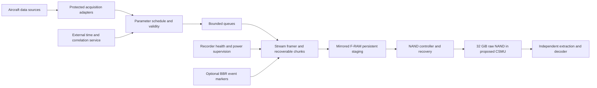

# Aviation BBR design: flight instrument data recorder

[Documentation index](README.md) | [Current BBR architecture (private; access required)](https://github.com/Ala-Ismail/BBR/blob/main/BBR%20architecture.md)

**Research date:** 8 November 2026  
**Status:** Requirements study and proposed design direction; no RTL or hardware changes  
**Intended use:** Evaluate BBR as the starting point for an aviation flight data recorder (FDR)

**Current scope:** Continuous recording of flight instruments, sensors, aircraft systems and crew control inputs (FDR). Cockpit voice/audio, images/video and communications-message recording are outside this design scope. Numerical navigation and aircraft-system data received over a digital bus remain in scope.

**Resized aviation planning baseline (8 November 2026):** MAX 10 `10M50DAF484I7G`, two 16-Mbit F-RAM devices for mirrored persistent staging, and a 32-GiB raw NAND archive providing at least 16 GiB of usable recording capacity. This replaces the inherited device/area limit for aviation planning only. See section 6.3 for assumptions, calculations and verification limits.


*Proposed architecture; implementation and hardware validation are pending.* [View editable SVG](images/aviation-bbr-top-level.svg).

## 1. Design conclusion and scope

BBR offers useful acquisition, buffering, serialization, CRC, storage and readback building blocks. Its present event recorder architecture is insufficient for a mandatory aviation flight recorder. The largest changes are continuous recording, hours of retained data, recovery of the latest data after sudden power loss, aircraft interfaces, crash-protected storage and certification evidence.

Develop an aviation variant with a continuous flight-data recording path. Retain BBR's triggered records as an optional diagnostic feature. This project focuses on an FDR, with the target aircraft and approval route still to be selected. It does not include developing a cockpit voice recorder (CVR) or combined recorder. Aircraft-level interfaces to any separately installed recorder still need assessment where required by the approval basis.

The instrument-data path is the subject of this proposal. It must record numerical measurements and discrete aircraft states, including applicable indications presented to the pilots. BBR's existing DSP sample interface is a starting point for this path. The next design work is to define the aircraft parameter dictionary, acquisition schedule, continuous storage format and independent data readout.

This study uses civil fixed-wing transport operations as the main reference and includes Australia, the United States and Europe. Helicopters, general aviation, experimental aircraft, military aircraft and uncrewed aircraft require separate applicability assessments. The target aircraft, operator and certification authority have not been selected. Consequently, the requirements below are a research baseline, not a final certification specification.

The existing [BBR architecture](https://github.com/Ala-Ismail/BBR/blob/main/BBR%20architecture.md) and [development instructions](https://github.com/Ala-Ismail/BBR/blob/main/AGENTS.md) in the private [BBR repository](https://github.com/Ala-Ismail/BBR) remain authoritative for the present implementation; access requires permission from the repository owner. Proposals here do not change its START/STOP behavior, cyclic allocation, maximum-sample closure, ten-record error limit, external time contract or mode exclusivity. Aviation changes need a separately approved architecture and versioned storage format.

## 2. Establish the applicable approval basis first

### 2.1 Requirements have several layers

| Layer | Purpose | Consequence for Aviation BBR |
|---|---|---|
| State operating rules | Determine which aircraft need recorders, retained duration and operational use | Select jurisdiction, operating category and aircraft dates before declaring compliance |
| Aircraft certification basis | Defines installation, power, segregation, sensor and other aircraft-level obligations | Assess the whole aircraft installation, including upstream acquisition |
| TSO/ETSO equipment standard | Establishes minimum equipment performance for the selected article approval | Record exact order revision, incorporated standard and accepted deviations |
| Industry performance standard | Defines recorder performance and qualification tests | Obtain the complete controlled standard and build clause-level compliance evidence |
| Development and environmental assurance | Addresses hardware/software processes and operating environment | Plan evidence and testing from requirements through production |

Do not equate equipment authorization with approval to install on a particular aircraft. Freeze both the article and installation approval routes with the authority. Guidance documents and acceptable means of compliance also have a different status from regulations.

### 2.2 Jurisdiction and duration findings

| Reference case | Verified finding | Design interpretation |
|---|---|---|
| US transport aeroplanes under 14 CFR 121.344 | Paragraphs (h) and (m) address 25 hours of FDR retention; the required parameter set depends on applicability provisions | Use 25 hours as the provisional FDR capacity target; select parameters using the actual aircraft basis. [14 CFR 121.344](https://www.ecfr.gov/current/title-14/chapter-I/subchapter-G/part-121/subpart-K/section-121.344) |
| EU commercial aeroplanes | CAT.IDE.A.190 generally specifies 25-hour FDR retention, with a ten-hour case for certain older small aeroplanes | Select the applicable aircraft cohort and parameter set. [Regulation 965/2012, consolidated 25 May 2026](https://eur-lex.europa.eu/legal-content/EN/TXT/HTML/?uri=CELEX:02012R0965-20260525) |

For **Australia**, Part 121 MOS section 11.29 addresses FDR carriage. Section 11.32 provides FDR compliance routes through CAO 103.19 or (E)TSO-C124a, requires the last 25 hours of flight data and preservation of the last two flight-data calibrations. Section 11.33 specifies continuous operation during defined flight-related periods, with qualifications. [Australian Part 121 MOS, compilation 5, 14 March 2026, Division 7](https://www.legislation.gov.au/F2020L01561/2026-03-14/2026-03-14/text/original/epub/OEBPS/document_1/document_1.html)

**Provisional project target:** 25 hours of continuous instrument and aircraft-system data. This is an engineering planning target until applicability is agreed, not a claim that every aircraft legally requires the same retention duration.

### 2.3 Standards and documents to control

| Document family | Relevance | Research status / action |
|---|---|---|
| ICAO Annex 6, relevant part; Annex 13 | International operational framework and accident-investigation context | Obtain current editions, amendments and applicability dates; map to state implementation. ICAO publishes information on Annex 6 amendments affecting recorder functions. [ICAO OPS annexes](https://www.icao.int/operational-safety/OPS-Section-Annexes-and-PANS) |
| TSO-C124 / ETSO-C124 family | Flight data recorder systems | Agree exact revision; do not assume every operating rule requires the newest revision. [EASA ETSO list](https://www.easa.europa.eu/en/domains/aircraft-products/etso/list-of-all-etso) |
| EUROCAE ED-112A / ED-112B | Crash-protected airborne recorder performance | ED-112B is published and covers changes including displayed information and crew selections. Its availability does not automatically replace the edition incorporated by an approval basis. [EUROCAE ED-112B](https://www.eurocae.net/product/ed-112b-minimum-operational-performance-specification-for-crash-protected-airborne-recorder-systems/) |
| ED-155 family | Potential lightweight recorder route | Investigate only if the selected aircraft and operation permit it; do not substitute for a required crash-protected FDR |
| ED-80 / DO-254; FAA AC 20-152A | Airborne electronic hardware development assurance | Determine applicable objectives and assurance level for FPGA, custom hardware and supporting COTS components. [FAA AC 20-152A](https://www.faa.gov/documentLibrary/media/Advisory_Circular/AC_20-152A.pdf) |
| ED-12C / DO-178C; FAA AC 20-115D | Airborne software assurance | Applies to relevant embedded acquisition, control and decoding software according to its certification role; assess tool qualification separately. [FAA AC 20-115D](https://www.faa.gov/documentLibrary/media/Advisory_Circular/AC_20-115D.pdf) |
| DO-160 environmental qualification | Aircraft operating environmental conditions | Select installation-specific categories and accepted revision. FAA AC 21-16G recognizes DO-160 versions including G and encourages G for new articles. [FAA AC 21-16G](https://www.faa.gov/airports/resources/advisory_circulars/index.cfm/go/document.information/documentNumber/21-16G) |

Full paid standards were not acquired or reviewed for this study. Detailed recorder performance, crash-test sequences, pass/fail limits, amendments and standard-specific latency requirements remain **TBD pending controlled documents**. Public summaries are not substitutes for those clauses.

## 3. Aviation requirements baseline

Here **R** means a sourced regulatory requirement for the stated reference case; applicability still needs confirmation. **P** means a proposed Aviation BBR engineering requirement or a derived allocation, rather than a quoted regulation. **TBD** means a value or scope that must be fixed before implementation.

### 3.1 Recording, acquisition and time

| ID | Type | Requirement / allocation | Acceptance evidence |
|---|---|---|---|
| AV-001 | P | Maintain an approved FDR applicability matrix covering aircraft category, mass, seats, operating part, relevant dates and required instrument/system parameters | Authority-reviewed basis and clause compliance matrix |
| AV-002 | R | Meet the applicable FDR retention obligation; the US Part 121 reference is 25 operating hours | Full-duration retained-data test against the selected paragraph. [121.344(h)/(m)](https://www.ecfr.gov/current/title-14/chapter-I/subchapter-G/part-121/subpart-K/section-121.344) |
| AV-003 | P | Record continuously throughout the applicable operating window; normal chunk rollover, event marking and diagnostics shall not interrupt acquisition | Automated start/stop, rollover and maintenance-state tests |
| AV-004 | P | Define every required parameter's source, units, encoding, range, accuracy, resolution, maximum interval, latency and validity treatment | Approved parameter dictionary and end-to-end calibrated measurements |
| AV-005 | R | For the US Appendix M reference, satisfy parameter-specific performance under static and dynamic conditions and correlate recorded data within one second | Dynamic sensor-to-decoder tests. [Appendix M to Part 121](https://www.ecfr.gov/current/title-14/chapter-I/subchapter-G/part-121/appendix-Appendix%20M%20to%20Part%20121) |
| AV-006 | P | Preserve acquisition timestamps and source identity; explicitly represent unavailable, stale, invalid and missing data without silently replacing them with plausible values | Source disconnect, delay, invalid-data and scheduling tests |
| AV-007 | P | Record unambiguous time across wrap, reset and loss/recovery of external synchronization; retain time quality, epoch and correlation metadata | Long-duration, reset and time-step tests with independent reference |
| AV-008 | P | Define bounded loss/latency budgets from source through nonvolatile storage; include all queues and upstream DSP buffering | Worst-case timing and queue analysis plus overload tests |

### 3.2 Storage, fault behavior and evidence preservation

| ID | Type | Requirement / allocation | Acceptance evidence |
|---|---|---|---|
| AV-009 | P | Use cyclic storage sized for the complete retention window at the worst configured data rate, including metadata and usable-capacity derating | Capacity calculation and full-media wrap test |
| AV-010 | P | Finalize independently recoverable short chunks during recording; abrupt power loss shall not invalidate an entire flight | Power interruption at each data/metadata update phase |
| AV-011 | P | Specify the maximum recoverable tail loss in milliseconds and bytes (**TBD**, subject to approved performance requirements) | Byte-accurate comparison between accepted and recovered streams |
| AV-012 | P | Prevent ordinary commands, reset, failed update or corrupt metadata from erasing the required retained history | Negative command, reset, recovery and metadata fault tests |
| AV-013 | P | Detect corruption using justified end-to-end integrity checks; assess ECC, redundancy, bad-block handling, endurance and retention for the selected media | Fault injection, media analysis and environmental data-retention tests |
| AV-014 | P | Preserve readable evidence after capture electronics or the normal host interface fails; supply independent extraction tools and a documented format | Recovery using storage hardware and a separate decoder |
| AV-015 | R | For the US 121.344(i) case, preserve recorder data for at least 60 days after a qualifying occurrence ending the flight, or longer when requested | Operator preservation procedures and custody records. [121.344(i)](https://www.ecfr.gov/current/title-14/chapter-I/subchapter-G/part-121/subpart-K/section-121.344) |
| AV-016 | P | Define incident preservation and controlled maintenance/erase procedures; do not let normal cyclic overwrite defeat the applicable preservation duty | Operational workflow tests and access-control review |
| AV-017 | P | Record recorder health independently of short event error budgets; a fault storm shall not displace mandatory flight data or hide persistent recording failure | Sustained error, storage stall and health-annunciation tests |

CRC detects certain data errors; it is not error correction, proof of sensor accuracy, authenticity or crash survivability. Select integrity coverage using an explicit fault model. Optional encryption must preserve authorized investigator access after host failure and key-management faults.

### 3.3 Aircraft power, installation and health

For the transport-category reference, 14 CFR 25.1459 addresses reliable power, preflight checking of actual recording, external electrical failure segregation and crash-related erasure protection. Sections 25.1457 and 25.1459 also govern recorder containers and installations; assess permitted combination configurations explicitly. [25.1459](https://www.ecfr.gov/current/title-14/chapter-I/subchapter-C/part-25/subpart-F/section-25.1459)

| ID | Type | Requirement / allocation | Acceptance evidence |
|---|---|---|---|
| AV-018 | P | Allocate aircraft bus inputs, protection, brownout behavior and hold-up energy; include acquisition sources, adapters and external time service where continued instrument recording depends on them | Power-tree failure analysis, interruption and switchover tests |
| AV-020 | P | Demonstrate that recorder interfaces, loads, faults and maintenance actions do not compromise essential aircraft systems | Electrical isolation, bus loading and aircraft safety analyses |
| AV-021 | P | Provide preflight and maintenance checks that exercise the acquisition-to-storage path; distinguish power present from successful recording | Deliberately failed sensor, bus, buffer, media and decoder tests |
| AV-022 | P | Define automatic flight-related operation and post-impact preservation as aircraft-level functions; do not assume a bare START/STOP input provides compliant logic | Aircraft-state truth table, failure analysis and transition tests |
| AV-023 | P | Verify physical I/O timing, CDC, reset and electrical compatibility for each selected interface | Board STA, CDC review, signal-integrity checks and interface testing |

FDR power endurance and any alternate supply allocation must follow the selected approval basis and aircraft power architecture. A voice-recorder battery duration is not an FDR design requirement.

### 3.4 Crash protection and location

The recorder needs a crash-survivable memory unit (CSMU), qualified mounting, enclosure, connectors and recoverable storage. FPGA timing closure cannot establish any of these properties.

| Qualification topic | Required design work | Numeric status |
|---|---|---|
| Impact, penetration and crushing | Define CSMU structure, retained-memory mounting and post-test recovery | Exact loads, pulse shapes, axes, fixtures and sequence: TBD from accepted ED-112 edition |
| High-temperature and prolonged fire | Thermal barrier, insulation, heat paths and retained-memory temperature limits | Exact temperatures, heat fluxes, duration and combined sequence: TBD |
| Deep-water pressure and immersion | Seals, corrosion protection and post-immersion extraction | Exact pressure, duration and fluid conditions: TBD |
| Aircraft fluids and contamination | Materials compatibility and recovery after exposure | Fluids, exposure sequence and acceptance criteria: TBD |
| Normal aircraft environment | Temperature, altitude, vibration, humidity, EMI, RF susceptibility, lightning-related effects and power transients as applicable | Installation-specific DO-160 categories: TBD |
| Location and recovery | High-visibility identification, locator equipment, attachment and maintenance | Select approved equipment and applicable operating requirements |

For scale only, the NTSB public overview lists **3,400 g for 6.5 ms**, **1,100 °C for 30 minutes** and **20,000 ft submerged pressure**. These are explanatory examples, **not the complete qualification specification for a new ED-112 design**. The overview also contains legacy recorder information. Do not adopt its older fire or beacon figures in place of controlled standards. [NTSB recorder overview](https://www.ntsb.gov/news/Pages/cvr_fdr.aspx)

For EU CAT non-deployable aeroplane FDR reference cases, the cited rule requires underwater location assistance with **at least 90 days** of transmission. A deployable recorder uses a different locator arrangement. This is separate from aircraft distress tracking, an ELT and the large-aircraft low-frequency locating function. [CAT.IDE.A.190(e)](https://eur-lex.europa.eu/legal-content/EN/TXT/HTML/?uri=CELEX:02012R0965-20260525)

### 3.5 Instrument-recording allocations and scope tracking

The following proposed allocations make the instrument-recording focus explicit:

- **AV-028 (P):** Maintain a versioned instrument/system parameter dictionary with stable parameter and source identifiers, conversion/calibration references, validity definitions and recording schedules.
- **AV-029 (P):** Record commanded values, measured responses and displayed indications separately where required; preserve redundant-source and pilot-station identity.
- **AV-030 (P):** Verify each parameter's maximum recording interval, source age and end-to-end latency under worst-case simultaneous updates and storage stalls.
- **AV-031 (P):** Provide independent decoding and engineering-unit export of recorded instrument data, with timestamps, quality flags and explicit missing-data intervals.

Earlier draft IDs AV-019 and AV-024 through AV-027 are retired from the active baseline following the instrument-only scope decision; their numbers are reserved. They covered voice-recorder power and proposed voice/message/combined-recorder functions. Instrument-data access and preservation remain covered by AV-012, AV-015 and AV-016. Any required synchronization reference or electrical segregation involving a separately installed CVR remains an FDR installation interface, without adding audio capture to this project.

## 4. Flight instruments, sensors and aircraft-system data

### 4.1 Instrument and system coverage

The following groups define the scope to assess for the FDR parameter dictionary. Entries are examples from published flight-data requirements, not a declaration that every listed signal is mandatory on every aircraft. Select individual parameters and recording performance through the applicability matrix.

| Data group | Examples to assess |
|---|---|
| Flight instruments / air data | Pressure altitude, indicated/calibrated airspeed, heading, outside/total air temperature |
| Attitude and motion | Pitch, roll, vertical, longitudinal and lateral acceleration |
| Navigation and approach | Position, ground speed, radio altitude, approach deviations and navigation selections |
| Engine and propulsion | Each engine's thrust/power parameters, thrust lever position, reverse-thrust status |
| Pilot control inputs | Pitch/roll controls, rudder pedals and trim inputs |
| Actual aircraft configuration | Control-surface positions, flaps, slats, spoilers, landing-gear and air/ground states |
| Automatic flight systems | Autopilot, autothrottle and flight-control modes and engagement |
| Warnings and system condition | Master and specific warnings, hydraulic/electrical states and relevant failures |
| Crew-selected indications | Selected targets, settings and applicable values displayed at each pilot station |
| Time and communication correlation | Time reference, radio keying and FDR/CVR synchronization |

Sources: [US 14 CFR 121.344 parameter list](https://www.ecfr.gov/current/title-14/chapter-I/subchapter-G/part-121/subpart-K/section-121.344) and [EASA FDR parameter tables](https://www.easa.europa.eu/en/document-library/easy-access-rules/online-publications/easy-access-rules-air-operations?erules-id=ERULES-1963177438-12637).

### 4.2 Proposed instrument-data acquisition contract

These are proposed design allocations under AV-004, AV-006 and AV-008:

- Identify every source and channel. Keep captain/first-officer, engine and redundant sensor identities separate when the approved parameter list requires them.
- Distinguish a commanded value, a measured response and a displayed indication. For example, an autopilot altitude selection and measured pressure altitude need separate parameter IDs.
- Preserve raw values and a controlled conversion/calibration dictionary so readout can reproduce engineering units. Do not record only chart images or formatted display text for numerical parameters.
- Timestamp acquisition and track source age. Mark stale, failed and unavailable inputs explicitly; do not present the last good value as a fresh measurement.
- Schedule each parameter at its required rate. Faster DSP transfers do not compensate for an upstream sensor updating too slowly.
- Bound buffering and service delays so all required channels remain recordable during simultaneous updates, fault bursts and storage stalls.

For example, a proposed pressure-altitude record needs a parameter/source identifier, raw value, acquisition time, validity and a reference to the active calibration/schema. Its exact wire format is an aviation-architecture decision. The present six-word BBR payload remains unchanged until that format is approved.

### 4.3 Parameter rates and performance

Aircraft-level acquisition must reconstruct flight path, aircraft state, engine operation, configuration and crew/system actions. EASA's published FDR AMC includes parameters such as GNSS time correlation, displayed air data, flight controls, warnings and system modes; applicability and performance tables depend on the aircraft. [EASA AMC1.2 CAT.IDE.A.190](https://www.easa.europa.eu/en/document-library/easy-access-rules/online-publications/easy-access-rules-air-operations?erules-id=ERULES-1963177438-12637)

Examples from the **US Appendix M** illustrate why the dictionary needs per-parameter rates; this is not a complete parameter list:

| Parameter | Example maximum recording interval | Applicability caution |
|---|---:|---|
| Time / relative time | 4 s | Table specifies time accuracy and resolution separately |
| Pressure altitude | 1 s | Range and accuracy requirements also apply |
| Indicated/calibrated airspeed | 1 s | Encoding resolution is not sensor accuracy |
| Normal acceleration | 0.125 s | 8 Hz; sensor placement and dynamic response matter |
| Pitch attitude | 1 s or 0.25 s | Depends on the referenced aircraft applicability |
| Roll attitude | 1 s or 0.5 s | Depends on the referenced aircraft applicability |
| Radio transmission / synchronization reference | 1 s | Discrete; preserve correlation with communications |

Use the complete table, footnotes and operating rule for the selected aircraft; there is no universal parameter count. [Appendix M performance table](https://www.ecfr.gov/current/title-14/chapter-I/subchapter-G/part-121/appendix-Appendix%20M%20to%20Part%20121)

For every dictionary entry, record: parameter ID; source equipment/bus/label; raw representation; engineering conversion; valid and failure states; acquisition and recording periods; jitter/latency; timestamp meaning; range, resolution and accuracy; calibration; decoder version; and verification reference. Preserve source freshness even if a DSP presents six words atomically: a common reception timestamp does not establish simultaneous physical measurement.

## 5. Current BBR capability and gap assessment

The facts in this section come from local project documents, primarily [BBR architecture](BBR%20architecture.md), [README](README.md), [verification results](sim/VERIFICATION.md) and [FPGA results](fpga/RESULTS.md). They are not aviation approval evidence.

| Current BBR behavior | Reusable contribution | Aviation gap / proposed action |
|---|---|---|
| Six 32-bit words every 250 µs; 4,000 complete samples/s | Assembly, ordering and flow-control patterns | Add an aircraft parameter model and heterogeneous source acquisition; six words do not imply six compliant aviation parameters |
| Forty-record rolling RAM history | Non-power-of-two history and boundary handling | Only 10 ms at nominal cadence; required retained history needs continuous nonvolatile storage |
| Triggered START/STOP events; count-limit closure | Optional incident annotations | Add a separate continuous recorder path; event capacity must not end mandatory recording |
| Eight 262,144-byte slots in 2,097,152-byte F-RAM | Bounded addressing and cyclic replacement | Storage is orders of magnitude too small at the current rate; fixed event slots waste capacity for continuous retention |
| Event header committed only after drain | Integrity-checked finalized events | Reset rejects an uncommitted event; use recoverable chunks so loss of power does not lose the ongoing flight |
| Low 32 timestamp bits per sample; full event boundary times | External coherent time interface | Intermediate wrap epochs can be ambiguous in long/sparse recordings; use full or reconstructably anchored times |
| Exclusive Config, Op and Read modes | Predictable ownership | Define recording priority; downloads or maintenance shall not interrupt a required recording window |
| Ten error transitions per event with overflow metadata | Duplicate suppression and bounded diagnostic traffic | Add continuous health reporting without changing the current event feature's contract |
| DSP-dependent input and readback | Internal ready/valid transaction design | Assess DSP/common-power failure; support independent recovery from retained memory |
| Generic VHDL RAM/FIFOs and serialized CRC | Portable, modular implementation | Reassess corruption detection, mitigation, resource use and assurance objectives |
| Reset recovery scans valid event headers for largest ID | Tested event recovery behavior | Define durable stream epochs/chunk identities and reconstruction when metadata is damaged |
| 75 MHz MAX 10 core, inferred RAM and SPI | Existing feasibility platform | Component grade, reliability, configuration integrity, operating environment and aircraft I/O remain separate decisions |

The latest local fit report records **6,724 fitted LEs**, **26 M9Ks** and **1,276 LEs of headroom under the 8,000-LE project budget**, on provisional commercial-grade `10M16DAF484C7G`. This is a core-only feasibility result with provisional I/O constraints. It establishes neither aviation environmental suitability nor board timing closure. Do not assume new acquisition adapters, ECC or a new storage controller fit in that headroom. [FPGA implementation results](fpga/RESULTS.md)

## 6. Storage and bandwidth sizing

These are calculations from BBR's present format and an illustrative instrument parameter schedule, not regulatory encoding requirements. Decimal GB and binary GiB are distinguished. Only instrument and aircraft-system data are included.

### 6.1 Retaining the current BBR sample stream

```text
Current sample rate                  = 4,000 records/s
Stored sample frame                  = 35 bytes
Continuous sample data rate           = 140,000 bytes/s
25 hours                             = 90,000 seconds
25-hour sample storage                = 12,600,000,000 bytes
                                     = 12.6 GB, approximately 11.74 GiB
Raw 18.75 MHz SPI ceiling              = 2,343,750 bytes/s
Sample frames / raw SPI capacity       = approximately 5.97%
```

Opcode/address traffic, chip-select gaps, metadata, diagnostics, recovery, media stalls and any shared reads consume additional bandwidth. The raw SPI percentage alone is not proof of sustained service.

The default slot allows `floor((262144 - 256 - 270) / 35) = 7474` sample records. With 40 prehistory samples, at most 7,434 live records remain: **1.8585 seconds** at nominal cadence. Eight full slots contain 59,792 sample records, or **14.948 seconds of sample-equivalent data**. They do not provide a continuous 14.948-second flight history: event gaps and repeated prehistory alter coverage. An ideal unformatted 2 MiB at this rate lasts only about **14.98 seconds**.

### 6.2 Size from the instrument parameter schedule

The present 4,000-record/s BBR stream is an existing implementation profile, not an aviation parameter schedule. Size the aviation stream by summing each parameter's encoded width and required recording rate, then adding framing, timestamps, quality and integrity overhead.

```text
Parameter-value byte rate             = sum(encoded_bytes_i * recordings_per_second_i)
Illustration only: 100 parameters,
each 4 bytes at 4 recordings/s         = 1,600 bytes/s of values
25-hour value-only storage             = 144,000,000 bytes = 144 MB
```

The uniform four-recordings/s example is arithmetic only, not an acceptable rate allocation for all instruments; faster parameters need their required rates. It excludes all record overhead. Per-parameter records and bundled periodic frames have different overheads. Choose the format after approving the dictionary and schedule, and measure the resulting worst-case stored byte rate. Neither 144 MB nor the existing-profile 12.6 GB is a finalized aircraft storage requirement. Do not reduce rates or discard raw information merely to meet a capacity target.

Use:

```text
required_usable_bytes >= retention_seconds * worst_case_stored_bytes_per_second
                        + chunk/index/calibration metadata
                        + reserved preservation capacity
                        + bad-block, ECC and endurance allowances
                        + approved engineering margin
```

Select media using **usable** capacity, not its label. Include all required instruments, discrete states, calibration/schema information and recorder diagnostics. Section 6.3 selects a conservative planning envelope using the existing BBR stream; the aircraft-specific dictionary still determines the final required rate.

At the existing 75 MHz external time example, low-32 ticks wrap every **57.266 seconds**, roughly **1,572 times in 25 hours**. A new aviation format must remove that ambiguity without introducing timestamp-based closure into the present BBR.

### 6.3 Resized FPGA and nonvolatile storage baseline

The user requested resizing the FPGA and F-RAM for the aviation target on 8 November 2026. Size against **25 hours at the existing 140,000-byte/s framed sample rate**, rather than the much smaller illustrative dictionary in section 6.2. Allocate an additional **25% byte-rate budget** for the aviation format, fuller timestamps, chunk metadata, quality information and diagnostics. This is an engineering allowance, not a regulatory margin. The final encoded stream must be measured and remain within it; otherwise resize again.

| Item | Existing BBR baseline | Resized aviation planning baseline |
|---|---|---|
| FPGA | MAX 10 `10M16DAF484C7G`, commercial, speed grade 7 | **MAX 10 `10M50DAF484I7G`**, industrial, 484-ball FBGA, speed grade 7 |
| Logic capacity | 15,840 fitted-device LEs; current design uses 6,724 | Nominal **50k-LE class**; aviation planning budget **30,000 fitted LEs** |
| Embedded RAM | 61 M9Ks; current design uses 26 | **182 M9Ks**, 1,677,312 physical memory bits |
| Core clock | 75 MHz | **75 MHz**, retained; no higher frequency assumed |
| Persistent staging | Existing 2 MiB F-RAM serves short events | **2 × 16-Mbit F-RAM**: 4 MiB physical, **2 MiB mirrored logical** |
| Bulk retained archive | No separate bulk archive | **32 GiB raw NAND** (256 Gibit aggregate), with **at least 16 GiB usable** after all media/layout reservations |
| Continuous stored-rate ceiling | Existing sample frames: 140,000 bytes/s | **175,000 bytes/s**, including the 25% format/diagnostic allowance |
| Retention allocation | Seconds of event data at current rate | **25 hours minimum** at the aviation stored-rate ceiling |

The manufacturer's MAX 10 resource table identifies the 10M50 as the 50k-LE class with 1,638 Kibit of M9K memory, equivalent to 182 × 9,216-bit blocks. Package resources must be checked separately from family maxima. [Altera MAX 10 resources](https://docs.altera.com/r/docs/683658/current/max-10-fpga-device-overview/max-10-device-maximum-resources) The selected ordering code is documented by the manufacturer. [10M50DAF484I7G device record](https://docs.altera.com/v/u/resources/695493/max-10-fpga-10m50daf484i7g-mdds)

The industrial grade is a component selection, not aviation qualification. Its junction-temperature limits differ from ambient-temperature limits and from the memory devices' ratings; assess the complete thermal environment. [MAX 10 operating conditions](https://docs.altera.com/r/docs/683794/current/max-10-fpga-device-datasheet/recommended-operating-conditions) Matching the old package ball count does not establish pin, supply or board compatibility. No board pins are assigned.

#### Capacity proof and the all-F-RAM alternative

```text
Existing framed sample stream           = 140,000 bytes/s
Aviation stored-rate budget             = 140,000 * 1.25 = 175,000 bytes/s
25-hour usable archive requirement      = 175,000 * 90,000
                                        = 15,750,000,000 bytes
                                        = approximately 14.67 GiB
Selected usable recording capacity      = 16 GiB = 17,179,869,184 bytes
Capacity above that requirement         = 1,429,869,184 bytes
Retention at the stored-rate ceiling    = approximately 27.27 hours
```

The 16 GiB must be available to the recording stream **after** ECC/parity, factory and grown bad blocks, wear-management reserve, indexes, calibration storage and any preservation reservation. The 32-GiB raw allocation gives room for these costs; the selected NAND organization must prove the usable-capacity guarantee. It is not an assertion that every 32-GiB device automatically provides it. Additional independent full-history replicas require their own complete archive capacity.

A representative Infineon F-RAM is **16 Mbit = 2 MiB**, not 16 MB or 16 GB. An all-F-RAM archive would require **8,192 such devices for 16 GiB**, before additional board-level redundancy. Increasing the FPGA cannot solve this density problem. Therefore the selected architecture keeps F-RAM as a short persistent staging area and adds bulk NAND for the 25-hour history. If all retained data must reside in F-RAM, this envelope is impractical and remains unresolved; no all-F-RAM implementation is claimed. [Infineon 16-Mbit F-RAM product](https://www.infineon.com/part/CY15B116QSN-108BKXI)

#### F-RAM selection and allocation

Select **two Infineon `CY15B116QSN-108BKXI`** devices as provisional staging components. Each is a 16-Mbit QSPI F-RAM in a 24-ball FBGA, rated by the manufacturer for 1.8–3.6 V and −40 to +85 °C. Its advertised interface maximum is 108 MHz; this design does not assume that clock. Validate the selected command mode, dummy cycles, voltage and signal timing before connecting it. [Manufacturer product specifications](https://www.infineon.com/part/CY15B116QSN-108BKXI)

| Per-device logical allocation | Bytes | Purpose |
|---|---:|---|
| Persistent circular staging | 1,572,864 (1.5 MiB) | Incoming records awaiting verified bulk-storage completion |
| Metadata and recovery reserve | 524,288 (0.5 MiB) | Redundant chunk descriptors, health/configuration metadata and spare capacity |
| Total per device | 2,097,152 (2 MiB) | The second device mirrors this allocation; capacities are not added |

The staging area holds about **8.99 seconds at 175,000 bytes/s** when empty. Set a provisional **five-second maximum bulk-storage service interruption**, consuming 875,000 bytes and leaving 697,864 bytes for pre-existing occupancy, bursts and scheduling margin. Verify worst occupancy; do not treat the full 8.99 seconds as available from every operating state. Target at least **1,000,000 payload bytes/s** of bulk service while it is available so the backlog can drain while recording continues. These are controller acceptance targets, not measured device performance.

Retain staging bytes until the corresponding bulk chunk is written and its integrity/commit checks succeed. Recovery must reconcile either F-RAM copy with committed archive chunks without duplication or silent gaps. Define degraded behavior when one copy fails, and report it. Mirroring does not protect against common power, controller, enclosure or systematic faults. Pending samples in volatile FPGA/DSP buffers still require a justified tail-loss and power-hold-up allocation. A bulk outage longer than the buffer budget needs explicit fault reporting; this finite staging area cannot guarantee indefinite recording through archive failure.

If F-RAM transactions use single-bit transfers at the existing 18.75 MHz rate, two writes plus one read require about **525,000 data bytes/s** at the stored-rate ceiling, or 22.4% of raw wire capacity. Verification reads, commands, address bytes, chip-select timing and retries increase that load. This calculation is a bus budget, not confirmation of command compatibility or service latency for the selected QSPI component.

#### FPGA resource and implementation allocation

The 10M50 provides headroom for continuous recording, staging/recovery logic, NAND handling and aircraft-interface adapters while retaining the installed MAX 10 tool family. Capacity is selected provisionally because the new RTL and full interface set do not exist yet; the larger part is not proof of a successful fit.

- **Logic:** Plan for no more than 30,000 fitted LEs, leaving roughly 40% of nominal device logic for routing flexibility and unresolved integration. This is a planning limit, not a synthesis estimate. Report fitted use by hierarchy after implementing each significant block.
- **Additional RAM budget:** Allocate 32 KiB for acquisition queues, 64 KiB for two 32-KiB chunk buffers, 16 KiB for readout and 16 KiB for health/metadata workspaces: **128 KiB total**. An 8-bit byte-oriented mapping can consume about 128 M9Ks before depth/width fragmentation. Together with the current 26 blocks, this suggests 154 of 182 blocks, leaving 28; verify actual inference and ECC workspace needs. This conservative sum retains the whole old core and is not a fitted resource result.
- **Processing:** Use generic VHDL synchronous RAM/FIFOs, serialized integrity processing and a byte-oriented controller. Keep `bbr_top` as integration wiring. No soft CPU, vendor memory IP or external DDR is assumed by this allocation.
- **Addressing:** Use a 64-bit logical byte/chunk address contract for the new archive. Existing 32-bit byte addresses cannot span 16 GiB; the existing three-byte SPI profile spans only 16 MiB. NAND page/block addressing is a separate device-specific translation. Avoid representing large byte capacities in VHDL `positive`/`integer` generics; use bounded block counts and explicitly sized unsigned arithmetic.
- **Format:** Introduce a versioned continuous-stream format and short recoverable chunks. The current eight event slots, 65,536-record cap and event directory are not a 25-hour archive. Preserve existing BBR behavior in its current configuration rather than increasing its generics and claiming aviation continuity.

Installed Quartus Prime Lite **20.1.1 Build 720** successfully recognized `10M50DAF484I7G` with speed grade 7 on 8 November 2026. The reproducible read-only query is [fpga/query_aviation_device.tcl](fpga/query_aviation_device.tcl); actual output is retained in ignored `fpga/build/aviation_sizing/query_device.log`. Reproduce with:

```powershell
& 'C:\intelFPGA_lite\20.1\quartus\bin64\quartus_sh.exe' -t fpga/query_aviation_device.tcl
```

This was a device-database query, not synthesis or fitting. The current `fpga/build.ps1` intentionally accepts only 10M16 ordering codes; it has not been silently retargeted. A separate aviation build profile must use the new device and 30,000-LE budget after implementing and behaviorally verifying the aviation RTL. No bitstream was generated.

#### Bulk memory and qualification boundary

Select a **32-GiB raw NAND bank inside the proposed CSMU**, with a device/controller combination that guarantees at least 16 GiB usable and satisfies the service-interruption, throughput, power-loss and lifetime budgets above. NAND technology and interface affect ECC strength, bad-block handling, latency and controller complexity; choose the exact organization after obtaining device limits. Manufacturer guidance distinguishes raw SLC, serial SLC and other NAND technologies. [Micron NAND selection guide](https://assets.micron.com/adobe/assets/urn%3Aaaid%3Aaem%3Ae98bc653-e42d-45a7-9b8c-03cb3d488f05/original/as/nor-nand-flash-guide.pdf)

The exact NAND ordering codes, ECC implementation and qualified CSMU construction remain open. A generic removable card is not selected as the crash-protected archive. Budget lifetime writes from stored rate × operating hours × write amplification, with worst-case endurance and retention at temperature; capacity alone is insufficient. If ECC or media management exceeds the FPGA budget, revise the controller/device allocation before claiming feasibility. The sized architecture meets the stated **capacity arithmetic**, while sustained service, FPGA fit, power-loss recovery and crash qualification remain verification work.

## 7. Proposed aviation architecture

This is an engineering proposal. It requires a new architecture review before implementation.


[Editable vector diagram](docs/images/aviation-bbr-top-level.svg) · [PNG diagram](docs/images/aviation-bbr-top-level.png) · [Reproducible renderer](docs/render_aviation_bbr_diagram.py)

The diagram separates external aircraft inputs, the proposed 10M50 FPGA logic, mirrored F-RAM staging, the NAND archive in a proposed CSMU and independent extraction. Solid arrows show data/storage paths; dashed arrows show control, time and health interfaces. Power supervision is shown logically; it is not a board power-distribution schematic. Regenerate both images with `python docs/render_aviation_bbr_diagram.py` (requires Pillow).

The following Mermaid diagram is a compact view of the recording path:



The drawing covers the instrument-data path only. It does not determine the required physical installation, recorder count or failure segregation from other aircraft equipment.

Proposed partitioning:

1. **Acquisition boundary:** Aircraft-specific adapters outside the reusable recorder core. Possible interfaces include ARINC 429, ARINC 717, Ethernet-based avionics buses, CAN, discretes and analog conversion; select only those needed by the target aircraft. Include transceivers, electrical isolation, source validity, timing and CDC.
2. **Continuous stream:** Scheduled parameter records with schema version, source identity, validity, sequence and unambiguous time. BBR event markers annotate this stream rather than enabling it.
3. **Recoverable storage:** Stage records in mirrored F-RAM, then append short chunks to the bulk NAND archive with integrity checks and recoverable metadata. Reclaim only old chunks beyond the retention obligation. Bound loss to the approved tail-loss allocation. Review media-specific atomic-write and erase behavior; F-RAM assumptions do not transfer directly to flash. Section 6.3 defines the provisional capacities and service budgets.
4. **Power and preservation:** Automatic recording enable, supply supervision, the approved FDR power allocation and post-impact preservation. Account for acquisition adapters and external time inputs as well as storage; available recorder power does not guarantee fresh instrument data if its sources have stopped.
5. **Diagnostics and extraction:** Recording takes priority. Provide bounded health traffic, preflight/maintenance tests and independent readout. Ground-only download is a possible first design choice, subject to operating procedures; a snapshot reader is another option if concurrency is required.

Retain portable VHDL storage contracts, byte-oriented processing, serialized CRC and clear module ownership where suitable. Retain 75 MHz. For the aviation variant, use the section 6.3 10M50 selection and 30,000-fitted-LE planning limit; the existing BBR 10M16 implementation and its 8,000-LE acceptance limit remain the historical baseline. Prove the aviation allocation through simulation and a separate fit before treating it as implemented.

### 7.1 FPGA versus microcontroller for Aviation BBR

The FPGA's main advantage is predictable instrument acquisition while several recording tasks run concurrently. Storage capacity alone does not require an FPGA. The comparison below is an engineering assessment for this design; actual timing and resource advantages must be demonstrated for the selected interfaces and implementation.

| Area | FPGA advantage | Microcontroller comparison |
|---|---|---|
| Multiple instrument inputs | Dedicated receivers can capture several interfaces concurrently, with separately allocated buffers | Available peripherals, DMA channels, shared buses and arbitration determine concurrency |
| Timestamp capture | Logic can latch time at a precisely defined input edge, independently of host software scheduling | Hardware timer capture can also be precise; timestamps taken in interrupt handlers have additional variable delay |
| Continuous recording | Acquisition, buffering, serialized CRC and storage control can run concurrently | DMA and a carefully bounded software schedule can also sustain continuous recording |
| Custom interfaces | Can implement specific DSP handshakes, unusual framing and aircraft-interface logic | May need external interface devices when suitable peripherals are unavailable |
| Host independence | Dedicated recording logic can continue while maintenance or host software is busy or stalled | Autonomous peripherals and DMA offer some similar protection, subject to buffer and software-service limits |
| Complex management functions | Dedicated hardware can enforce bounded behavior, but media-management changes require RTL design and verification | Firmware can simplify configuration, diagnostics and some storage-management functions |

Parallel hardware and configurable protocol processing support these FPGA advantages, but shared resources, clock-domain crossings and arbitration still need analysis. [Altera FPGA architecture overview](https://www.altera.com/why-fpgas) Modern microcontrollers support hardware timer events and DMA, so compare against a properly designed peripheral/DMA acquisition system rather than assuming software services every sample. [ST timer-triggered DMA documentation](https://www.st.com/content/st_com/en/technical-documents/an5593-how-to-use-the-gpdma-for-stm32-mcus-stmicroelectronics_asset/chunk-005-topic-an5593-gpdma-config-timers.html)

The following limits apply to this BBR design:

- **Throughput does not establish FPGA size.** The planned 175,000-byte/s stream is modest and does not by itself justify the 10M50. Required interfaces, worst-case service latency, buffering, ECC and storage-controller complexity must justify the allocation through implementation and fitting.
- **Timestamp granularity is not measurement accuracy.** Hardware capture fixes the observation edge; sensor delay, source age, clock quality and external synchronization still determine the accuracy of instrument timestamps.
- **Recording logic cannot reconstruct an unavailable source.** If the DSP supplies instrument data and stalls, the FPGA can preserve already accepted data and report gaps, but cannot recover measurements it never received. A claimed independent acquisition path needs sources and power that remain available independently of that DSP.
- **Reliability is a system property.** An FPGA does not automatically provide greater reliability or simpler certification. Custom logic requires development-assurance evidence; memory, power, electrical interfaces, crash protection and installation require separate evidence. [FAA AC 20-152A](https://www.faa.gov/documentLibrary/media/Advisory_Circular/AC_20-152A.pdf)

**Proposed partition:** Retain the FPGA for acquisition, timestamp capture, bounded queues, integrity processing and continuous recording control. Use the existing DSP for configuration and maintenance where its failure cannot silently defeat required recording. Decide whether NAND management belongs in FPGA logic or a separate storage controller after evaluating ECC, worst-case latency, power-loss behavior, resource use and assurance effort. A new microcontroller is not assumed by the current architecture.

Retain the 10M50 as the provisional planning device from section 6.3. Confirm or revise that selection using measured interface/service requirements and the actual aviation RTL fit. This comparison does not establish that a microcontroller solution is unsuitable or that the proposed FPGA implementation is already verified.

## 8. BBR improvement requirements toward aviation instrument recording

This section turns the gaps into a proposed development backlog for the aviation variant. These are engineering requirements derived from sections 3–7, not additional regulatory claims. All items below are **planned and unimplemented**. Completing the RTL items would establish a more capable recorder prototype; aircraft approval also requires the installation, environmental, crash-survival and assurance evidence described below.

Priority means implementation dependency: **P0** fixes the design inputs, **P1** establishes the continuous instrument-recording prototype, and **P2** establishes the hardware and assurance evidence needed to evaluate aviation use. P2 planning must begin early even though its completion depends on the implemented design.

### 8.1 Prioritized improvement requirements

| ID / priority | Required BBR improvement | Acceptance criterion | Aviation trace |
|---|---|---|---|
| IMP-001 / P0 | Establish the target aircraft and FDR applicability matrix; approve the parameter list, source interfaces, recording intervals, accuracy and retention requirements before fixing the format | Every required parameter has a source, performance allocation, applicability decision and verification reference; unresolved items have owners | AV-001, AV-004, AV-005 |
| IMP-002 / P0 | Define the aviation stream, chunk, metadata, recovery and DSP/host interface specifications as a new versioned architecture | Document byte order, field widths, validity, checksums, commit order, reset epochs, commands and compatibility; preserve the existing event-format contract | AV-007, AV-010, AV-028 |
| IMP-003 / P1 | Add a continuous recording controller alongside the existing triggered-event function; event markers shall not gate mandatory instrument recording | No missing required samples at event START/STOP, chunk rollover or ordinary diagnostics; record limits close a chunk rather than terminate the continuous stream | AV-002, AV-003, AV-022 |
| IMP-004 / P1 | Extend acquisition beyond the fixed six-word sample using parameter/source IDs, a controlled dictionary and deterministic scheduling; keep physical aircraft adapters separate | Verify commanded/measured/displayed values independently, required redundant-source identities, per-parameter intervals and calibration conversions | AV-004, AV-006, AV-028, AV-029, AV-030 |
| IMP-005 / P1 | Store unambiguous acquisition time, sequence/epoch information and time quality; continue consuming an external coherent time service | Independent decoding remains unambiguous across multiple low-32 wraps, DSP/FPGA restarts and invalid/recovered time; synchronization algorithms remain outside BBR | AV-005, AV-007 |
| IMP-006 / P1 | Record stale, unavailable, malformed and missing parameter data explicitly; define source-age and latency limits | Source disconnection, missed deadlines and partial inputs produce correct quality/gap indications; no stale value is silently represented as a fresh measurement | AV-006, AV-008, AV-030 |
| IMP-007 / P1 | Implement the mirrored F-RAM staging path and bulk NAND backend with separate portable storage contracts | Sustain the 175,000-byte/s complete-stream budget, tolerate the allocated five-second archive interruption at the proven starting occupancy, drain backlog and report degraded copies/failures | AV-008, AV-009, AV-013; section 6.3 |
| IMP-008 / P1 | Replace fixed-slot retention in the aviation path with bounded continuous archive allocation and 64-bit logical addresses | At least 16 GiB usable remains after reserves; retain at least 25 hours at the stored-rate ceiling; verify addressing beyond 4 GiB and reclaim only eligible old data | AV-002, AV-009, AV-012 |
| IMP-009 / P1 | Commit short recoverable chunks and reconcile persistent staging with the archive on reset; recover independently of one newest directory entry | Interrupt every data/descriptor/commit phase; retain prior valid chunks, reconstruct order, identify corruption and avoid duplicate delivery; measure tail loss against an approved limit | AV-010, AV-011, AV-013 |
| IMP-010 / P1 | Add aircraft-state recording control and a preservation/maintenance command policy for the aviation path | Verify the approved operating-state truth table; ordinary host commands, downloads and resets cannot silently defeat recording or required preservation | AV-003, AV-012, AV-015, AV-016, AV-022 |
| IMP-011 / P1 | Add continuous recorder-health counters, bounded fault transitions and end-to-end self-checks independent of the existing ten-record event log | Detect source, queue, time and storage faults; sustained error traffic does not starve instrument data; self-tests do not overwrite retained evidence | AV-017, AV-021 |
| IMP-012 / P1 | Provide independent chunk extraction, schema-aware decoding and instrument-data export; define recording-priority arbitration for any concurrent readout | A separate decoder reconstructs values, units, identities, timestamps and quality from retained media; read faults/retries do not consume data twice or interrupt recording | AV-014, AV-031 |
| IMP-013 / P2 | Add a separate aviation Quartus profile for `10M50DAF484I7G`, retaining generic VHDL RAM/FIFOs and serialized processing | Behaviorally verified aviation RTL fits at 75 MHz within the 30,000-fitted-LE planning limit and available RAM; report fitted hierarchy use, timing and constraints | AV-023; section 6.3 |
| IMP-014 / P2 | Design acquisition, recorder and memory power supervision, brownout/reset behavior and electrical isolation together | Hardware power cuts and source-supply failures meet the allocated recording/tail-loss behavior; board I/O timing, CDC and supply compatibility are verified | AV-018, AV-020, AV-023 |
| IMP-015 / P2 | Select and verify NAND organization, ECC, wear/bad-block management and the crash-protected memory assembly | Prove usable capacity, worst service gap and lifetime endurance/retention; recover instrument data after the applicable approved environmental and crash-test sequences | AV-009, AV-013, AV-014; section 3.4 |
| IMP-016 / P2 | Establish requirements traceability, independent verification where required, configuration control, calibration/maintenance records and installation evidence | Close the applicable hardware/software assurance objectives and qualification/installation findings; retain reproducible source, tool, test and decoder records | AV-001, AV-005, AV-015, AV-021; section 9 |

### 8.2 Implementation sequence and ownership

1. **Freeze the instrument-data contract:** Complete IMP-001 and IMP-002, including stored-rate, source-age and tail-loss allocations. Review section 6.3 sizing against the actual encoded parameter schedule. Keep FPGA-to-DSP synchronization in the external time service.
2. **Build and simulate the continuous path:** Implement acquisition/validity/time changes and continuous control, then chunking, persistent staging and archive recovery. Use behavioral F-RAM/NAND models with independent data/CRC scoreboards before hardware mapping. Provide a working independent decoder during format development.
3. **Verify system behavior under stress:** Exercise full retention and overwrite, source faults, storage stalls, degraded mirrors, abrupt reset, fault storms and readout contention. Use accelerated models for broad fault coverage and sustained operation testing for the retention/service-rate evidence; neither replaces the other.
4. **Fit and integrate hardware:** Use the separate aviation build profile, report actual resources, then verify power, electrical interfaces, board timing and media service limits on the selected hardware. Complete environmental/crash qualification and installation evidence against the agreed basis.

Keep each new state item under one module owner. The continuous controller owns recording state; acquisition owns source validity and scheduling; the chunk writer owns serialization/commit; the storage backend owns device transactions and media management; recovery owns reconstruction; readout owns export progress. Exact entity names and boundaries belong in the architecture review. Keep `bbr_top` as wiring and small integration logic, with generic synchronous RAM/FIFO contracts and no vendor simulation dependencies.

Existing event capture, cyclic slot selection/recovery, accepted-command timing and ten-entry error behavior remain the regression baseline. New stream allocation, recovery metadata and continuous health rules apply to the aviation path only. Do not add command-pulse pipelines, alter current event allocation, or claim equivalence for intentionally new behavior. Any shared-block refactor must preserve the existing BBR cycle timing and pass its directed regressions.

### 8.3 Completion criteria and unresolved inputs

The first implementation milestone is a **verified continuous instrument-recorder prototype**: every required parameter is decodable with its identity/time/quality; the complete stream fits the stored-rate budget; 25 hours are retained; chunk rollover does not interrupt recording; and reset/power-loss recovery satisfies the allocated tail-loss limit. Report the actual tests, measured rate, recovered loss, usable bytes and fitted resources, rather than marking completion from capacity calculations alone.

Aircraft selection, the complete parameter dictionary, permitted tail loss, exact NAND parts/ECC, power hold-up and physical CSMU design remain open inputs. Their unresolved values prevent declaring the aviation requirements satisfied. Voice recording remains outside scope.

## 9. Development assurance and verification plan

Assign hardware/software assurance levels from the aircraft safety assessment and accepted equipment basis. Do not assume a recorder automatically requires DAL A, or that all recorder functions have the same level. Development assurance, environmental qualification, crash survival and installation approval are separate evidence sets.

Create traceability from each applicable clause to system requirements, hardware/software allocations, design, verification procedures, results and unresolved issues. Control HDL, firmware, parameter dictionaries, tools, constraints, media layout and extraction software together. Assess the certification use of synthesis, simulation and analysis tools and any need for qualification or independent output verification. Use the cited FAA hardware/software guidance to establish the accepted process.

| Gate | Required evidence |
|---|---|
| G0: Approval basis | Aircraft/operation selected; regulatory matrix; controlled standards; authority agreement; safety assessment and assurance plan |
| G1: Architecture | Parameter dictionary; throughput/retention budgets; power/failure analysis; chunk recovery and preservation rules; new-format specification |
| G2: Behavioral verification | Existing BBR regression preserved; independent expected-data scoreboards for continuous recording, time, validity, corruption and reset |
| G3: Sustained operation | At least the target retention duration plus cyclic overwrite, maximum bursts, worst media service gaps, queue bounds and bounded download effects |
| G4: Power and recovery | Hardware power cuts at arbitrary write/erase/metadata phases; repeated brownouts; deterministic recovery and measured tail loss |
| G5: Implementation | Synthesis/fit, fitted hierarchy area, core and board I/O STA, CDC/reset review and target-environment component assessment |
| G6: Qualification | Approved operating-environment and crash-survival procedures; post-test instrument-data extraction, integrity and engineering-unit reconstruction |
| G7: Installation and operations | Sensor calibration, aircraft interface/power tests, recording start/stop, annunciation, maintenance, privacy and occurrence-preservation procedures |

Additional directed tests should include multi-wrap timestamps, clock discontinuities, source outages, DSP restart during flight, damaged newest metadata, media exhaustion, sequence rollover, repeated fault reports, recorder restart while power remains available, and recovery with the normal DSP interface disconnected. Test continuity across chunk boundaries and verify that a partial final chunk cannot invalidate earlier retained chunks.

Existing ModelSim and Quartus results can support reuse analysis. They are not evidence that the new aviation requirements have passed. This documentation change did not run a new simulation, synthesis, crash test or aircraft qualification.

## 10. Decisions required before implementation

| Decision | Required resolution |
|---|---|
| Product and market | Instrument-data recorder: supplemental diagnostic logger, eligible lightweight recorder or mandatory FDR? Which authority and operating part? |
| Aircraft | Type, mass, seats, propulsion, manufacture/CofA/type-certification dates and installation location |
| Approved scope | Applicable instrument/system parameter table, numerical displayed indications, source identities, recording rates and retention window |
| Approval basis | Exact TSO/ETSO and performance-standard editions, amendments, deviations and assurance objectives |
| Source interfaces | Equipment, buses, source rates, validity, calibration and end-to-end latency |
| Storage | Verify the 32-GiB raw / 16-GiB usable NAND allocation; select exact NAND parts, CSMU construction, endurance/ECC and tail-loss allocation; validate the two selected 16-Mbit F-RAM staging devices |
| Power and segregation | Normal/emergency/independent supplies, upstream-source endurance, impact logic and common-cause controls |
| Time | External synchronization service, correlation accuracy, epoch representation and degraded behavior |
| Operations | Download timing, erase access, incident preservation, privacy, maintenance and calibration retention |
| FPGA | Validate `10M50DAF484I7G`, 75 MHz, 30,000 fitted LEs and RAM allocation against implemented interfaces, power, environment and actual fit |

The recommended next deliverable is an aircraft-specific applicability and parameter matrix, followed by an aviation architecture specification. Until those decisions are made, BBR is a reusable prototype foundation, not an approved aviation black box.

## 11. Source and research limitations

Links are placed alongside the findings they support. Primary sources used were the US eCFR, Australian Federal Register of Legislation, EU/EASA, ICAO, FAA, EUROCAE and NTSB. Current web pages can change; retain dated controlled copies when establishing the certification baseline. The cited eCFR pages were current through late October/early November 2026; the Australian compilation is dated 14 March 2026 and the EU consolidated text 25 May 2026.

The complete ICAO annexes and paid EUROCAE/RTCA standards were not reviewed. Exact standard clauses and qualification limits remain open. The EASA online AMC link documents an ED-112A reference for its stated aircraft cohort; verify later decisions and accepted editions when freezing the project basis. No statement here establishes certification, board timing closure, crash survival or hardware readiness.
